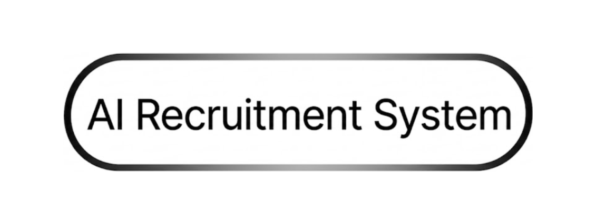
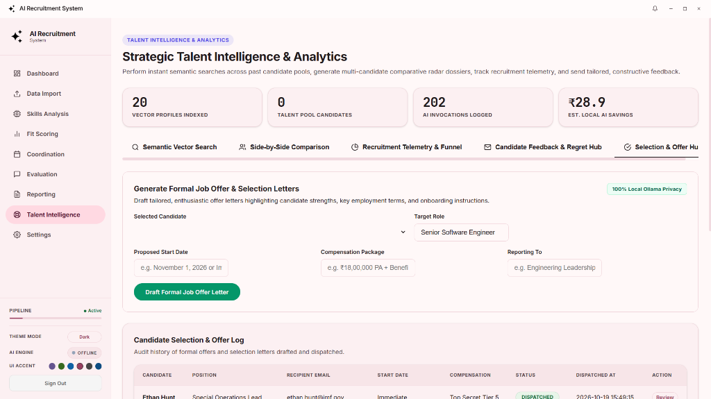
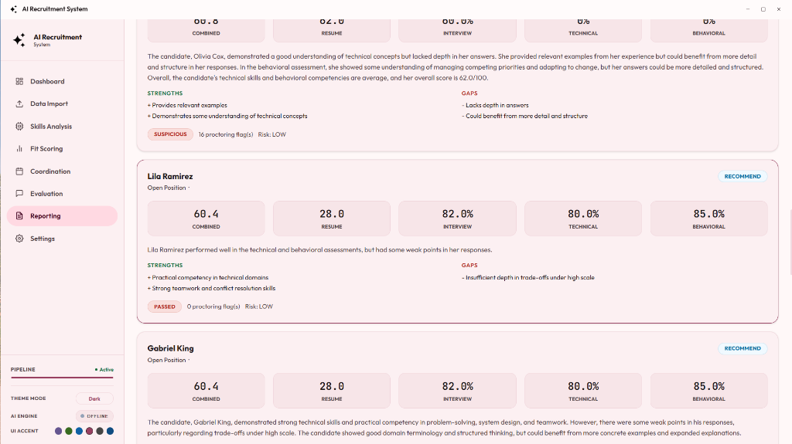
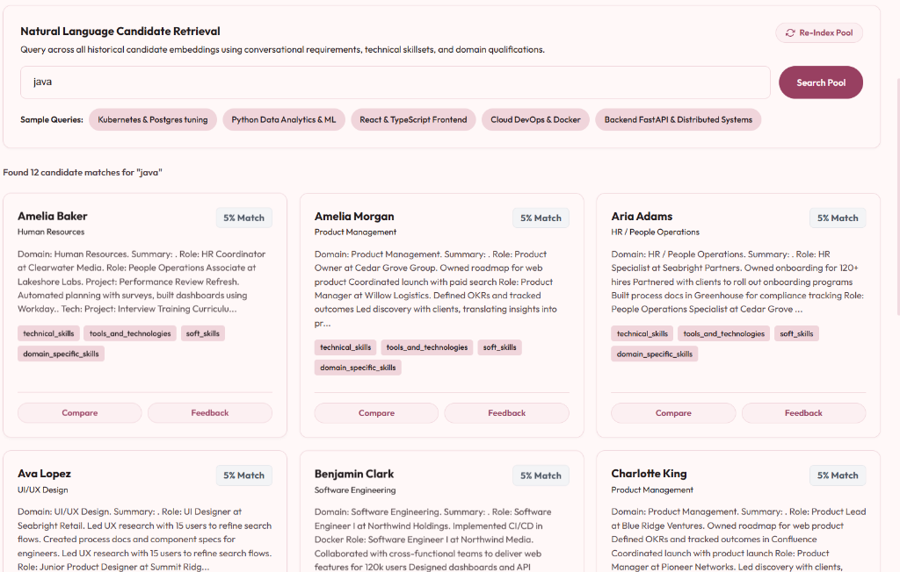
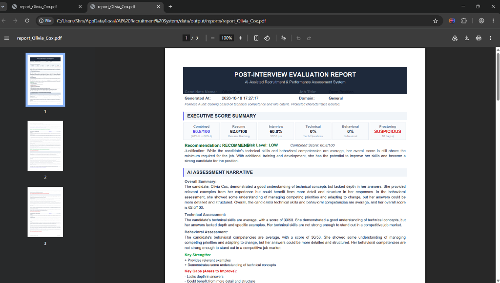

# AI Recruitment System (ARS)

> Privacy-first, offline-capable technical recruitment and remote proctoring platform.

<div align="center">
  

  <br><br>

  <p>
    <a href="https://github.com/shrs425p/AI-Recruitment-System/actions/workflows/ci.yml"></a>
    <a href="https://github.com/shrs425p/AI-Recruitment-System/actions/workflows/security.yml"></a>
    <a href="https://github.com/shrs425p/AI-Recruitment-System/actions/workflows/codeql.yml"></a>
    
    
    <a href="LICENSE"></a>
  </p>

  <p>
    <a href="https://github.com/shrs425p/AI-Recruitment-System/releases/latest"><b>Download Windows Installer (.exe)</b></a> &nbsp;|&nbsp;
    <a href="docs/index.md"><b>Documentation Hub</b></a> &nbsp;|&nbsp;
    <a href="DOCUMENTATION.md"><b>System Documentation</b></a> &nbsp;|&nbsp;
    <a href="https://github.com/shrs425p"><b>Follow @shrs425p (Maintainer)</b></a>
  </p>
</div>

---

## Application Showcase

| Operator Desktop Dashboard | Candidate Assessment & Rubric Scoring |
| :---: | :---: |
|  |  |
| **Natural Language Candidate Retrieval** | **Standardized Post-Interview PDF Report** |
|  |  |

---

## Overview

Traditional recruitment pipelines force teams to juggle disparate tools for resume screening, spreadsheet ranking, calendar booking, third-party video meetings, and subjective interview evaluations.

The **AI Recruitment System (ARS)** consolidates this entire workflow into a single local-first desktop application. From multi-format resume parsing and automated 5-dimension candidate ranking to token-secured live AI interviews, real-time computer vision proctoring, and comprehensive executive PDF reporting, ARS ensures fast, consistent, and privacy-compliant hiring.

---

## Table of Contents

- [Key Capabilities](#key-capabilities)
- [Quick Start](#quick-start)
  - [Option A: Windows Desktop Installer](#option-a-windows-desktop-installer-recommended-for-recruiters)
  - [Option B: Run from Source](#option-b-run-from-source-for-developers)
- [Interview Portal & Network Access](#interview-portal--network-access)
- [System Architecture](#system-architecture)
- [Supported AI Providers & Air-Gapped Mode](#supported-ai-providers--air-gapped-mode)
- [Limitations & Responsible AI Use](#limitations--responsible-ai-use)
- [Roadmap](#roadmap)
- [Testing & Quality Verification](#testing--quality-verification)
- [Documentation Index](#documentation-index)
- [License & Commercial Terms](#license--commercial-terms)
- [Contributing & Security](#contributing--security)

---

## Key Capabilities

| Capability | Module | Technical Implementation |
| :--- | :--- | :--- |
| **Multi-Format Ingestion** | Resume Parsing | Native `.docx` XML parsing via `python-docx`, digital PDF extraction via `pypdf`, and optical character recognition via Google Tesseract OCR 5.3. |
| **Structured NLP Extraction** | Profile Extraction | Normalizes unstructured resumes into validated JSON capturing skills, chronological experience, credentials, projects, certifications, and domain classifications. |
| **5-Dimension Candidate Ranking** | Applicant Ranking | Weighted scoring across Skills (35%), Experience (25%), Education (15%), Projects (15%), and Domain (10%) with dynamic weight normalization and hard knockout filters. |
| **Automated Interview Scheduling** | Coordination | Automatic weekday slot allocation, Google Calendar OAuth 2.0 Free/Busy conflict checks, RFC 5545 `.ics` generation, and automated SMTP STARTTLS invitation dispatch. |
| **Isolated Candidate Assessment** | Candidate Portal | Isolated HTTPS service on Port 5000 with single-use token lifecycle, server-pacing rules, and strict elapsed question timers. |
| **Real-Time Remote Proctoring** | Computer Vision | MediaPipe Face Mesh tracking 468 facial landmarks with OpenCV Haar cascade fallback; monitors face absence, multiple faces, tab switching, and copy-paste events. |
| **Adaptive Interview Bot** | Technical Assessment | Role-adaptive blueprints, configurable technical and behavioral questions, dynamic follow-up probing, and dual-layer voice input via Web Speech API or offline Vosk. |
| **Combined Fit Scoring & Reports** | Executive Reporting | Evaluates transcripts across 4 rubric dimensions, computes 40/60 combined fit score (40% resume + 60% interview), and compiles standardized Material Design 3 PDF dossiers via FPDF2. |
| **Talent Intelligence & Analytics** | Strategic Insights | 384-dimensional vector semantic search, multi-candidate comparison matrix, automated feedback letters, and 6 talent analytics visual modules. |
| **100% Air-Gapped Operation** | Local Data Sovereignty | Zero external CDN calls; bundled Inter and JetBrains Mono fonts; bundled local Chart.js bundle; on-device LLM inference via Ollama (`qwen3.5:0.8b` / `llama3.2:3b`). |

---

## Quick Start

### Option A: Windows Desktop Installer (Recommended for Recruiters)

For recruiters and HR operators who want a ready-to-run desktop application without managing Python environments:

1. Download the latest installer `ARS_Setup_3.0.0.exe` from [GitHub Releases](https://github.com/shrs425p/AI-Recruitment-System/releases/latest).
2. Run the setup executable and follow the installation wizard.
3. Launch the application via the desktop shortcut or Start Menu.
4. The desktop administration console will start automatically on `http://127.0.0.1:5001`.

---

### Option B: Run from Source (For Developers)

#### Prerequisites
- Windows 10/11 (64-bit)
- Python 3.10+ (tested up to Python 3.14)
- Git
- Optional for local AI: [Ollama](https://ollama.ai) installed with `ollama pull qwen3.5:0.8b` (or `llama3.2:3b`)

#### 1. Clone Repository & Setup Virtual Environment
```bash
git clone https://github.com/shrs425p/AI-Recruitment-System.git
cd AI-Recruitment-System

python -m venv venv
venv\Scripts\activate
pip install -r requirements.txt
```

#### 2. Download Offline Models (Optional for Air-Gapped Voice)
To enable offline speech recognition without cloud Web Speech dependencies, download the bundled Vosk acoustic model:
```bash
python scripts/setup_vosk.py
```

#### 3. Launch the Application
```bash
python main.py
```
- The native desktop administration window (`pywebview`) will launch automatically via loopback Waitress on `http://127.0.0.1:5001`.
- The public candidate assessment server will initialize on `https://<your-lan-ip>:5000`.

---

## Interview Portal & Network Access

The candidate assessment portal runs on **Port 5000** over HTTPS to satisfy modern browser security constraints for webcam and microphone streaming.

> [!IMPORTANT]
> **Browser Security Notice for Candidates**:
> The portal utilizes a local self-signed TLS certificate generated at startup. When candidates open their unique assessment link (e.g. `https://192.168.1.50:5000/candidate-interview/<token>`), browsers will display a standard warning: *"Your connection is not private"* or *"Potential Security Risk"*.
> Candidates must click **Advanced** -> **Proceed to [IP] (unsafe)** to accept the local certificate and enter the interview room.

---

## System Architecture

The platform enforces a strict two-server network isolation model to prevent candidates from accessing administrative endpoints:

```
[ Operator Desktop Window (pywebview) ]
               │
               ▼ Loopback HTTP (Port 5001)
     [ Waitress WSGI Server ]
               │
               ├── Flask Admin Engine (routes/api.py, intelligence.py, etc.)
               ├── Relational SQLite Database (ars.db - 13 Tables)
               ├── Machine-GUID AES-Fernet Encryption at Rest
               └── AI Provider Router (Ollama / NVIDIA NIM / Anthropic / Gemini / Groq)

                                    * * *

[ Candidate Devices on Local Area Network / VPN ]
               │
               ▼ Inbound HTTPS with Self-Signed TLS (Port 5000)
     [ Flask Candidate Assessment Server ]
               │
               ├── Single-Use Token Authentication (interview_tokens)
               ├── Server Pacing Engine & Enforced Timers
               ├── Real-Time MediaPipe Face Mesh & Proctoring Monitors
               └── Dual-Layer Speech Engine (HTML5 Web Speech + Offline Vosk)
```

---

## Supported AI Providers & Air-Gapped Mode

The system features a centralized `ProviderRouter` supporting **8 AI providers** with automatic failover, request-per-minute (RPM) rate tracking, and fallback tiers:

1. **Ollama** (Local on-device inference; zero external data transfer)
2. **NVIDIA NIM** (High-throughput cloud inference)
3. **Anthropic** (Claude series)
4. **Google Gemini** (Gemini 2.5 / 1.5 series)
5. **Groq** (Low-latency LPU inference)
6. **OpenAI** (GPT-4o series)
7. **OpenRouter** (Multi-model routing)
8. **GitHub Models** (Azure AI infrastructure)

> [!NOTE]
> Default model identifiers are dynamically configurable. See [docs/ai-providers.md](docs/ai-providers.md) for full configuration flags, API key placement, and latency benchmarks.

---

## Limitations & Responsible AI Use

The AI Recruitment System is designed to support, not replace, human recruiters. When deploying automated hiring systems, operators must adhere to responsible AI principles:

1. **Human-in-the-Loop Decision Support**:
   - AI-generated candidate ranking scores, interview rubric evaluations, and hiring recommendations are **decision-support advisory metrics**.
   - ARS must not be configured to autonomously hire or reject applicants without final human oversight and verification by a qualified hiring manager.

2. **Algorithmic Bias Mitigation**:
   - Pre-trained language models can reflect societal or historical biases in training data.
   - ARS mitigates evaluation bias through:
     - **Blind Screening Mode**: Anonymizes candidate names, contact information, gender indicators, and demographic references prior to LLM evaluation.
     - **Deterministic Knockouts**: Enforces hard objective criteria (e.g. required skills, minimum tenure) before subjective scoring occurs.
     - **Standardized Rubrics**: Evaluates all candidate interview answers against identical, rubric-grounded criteria.
   - Operators should periodically audit scoring distributions across demographic cohorts.

3. **Candidate Consent & Proctoring Privacy (GDPR / CCPA)**:
   - Live video proctoring, facial landmark tracking, and audio transcription require candidate informed consent.
   - All computer vision proctoring calculations (face presence, gaze angle, tab loss) are executed **locally in the browser and server memory in real time**. No raw video feeds or continuous audio recordings are uploaded to third-party cloud servers.
   - Anonymization and GDPR-compliant candidate data purge capabilities are built into the data management layer.

4. **Data Sovereignty & Airgap Guarantees**:
   - When running in Privacy Mode with local Ollama models, all resumes, transcripts, scores, and candidate data remain strictly on the host workstation with zero outbound telemetry.

---

## Roadmap

- [x] Multi-format resume parsing (`.docx`, `.pdf`, `.png`, `.jpg` via OCR).
- [x] 5-dimension applicant ranking with configurable knockout rules.
- [x] Token-authenticated live candidate interview portal.
- [x] Real-time MediaPipe computer vision proctoring and integrity scoring.
- [x] Standardized monochrome Material Design 3 PDF evaluation reports.
- [x] 384-dimensional vector semantic candidate search and intelligence matrix.
- [x] 100% offline air-gapped deployment mode with local fonts, charts, and models.
- [x] 197-unit automated verification test suite.
- [ ] Webhook integration for external ATS platforms (Greenhouse, Lever, Workday).
- [ ] Multi-language interview voice models (Spanish, German, Japanese).
- [ ] Distributed cloud database synchronization for multi-recruiter teams.

---

## Testing & Quality Verification

The platform maintains comprehensive test coverage across 15 domain-scoped test suites covering security, air-gap enforcement, encryption, candidate offers, proctoring, and interview workflows.

To run the automated test suite:

```bash
venv\Scripts\pytest -v
```

```text
======================= 197 passed in 86.85s (0:01:26) ========================
```

---

## Documentation Index

Detailed architectural breakdowns, security models, and administrative specifications are available in the documentation library:

| Document | Focus & Contents |
| :--- | :--- |
| [System Documentation](DOCUMENTATION.md) | Comprehensive single-file reference for architecture, APIs, schemas, and operations. |
| [Getting Started](docs/getting-started.md) | Installation prerequisites, environment validation, and first-run guide. |
| [Architecture Guide](docs/architecture.md) | Two-server network isolation model, subsystem boundaries, and thread topologies. |
| [Pipeline Guide](docs/pipeline.md) | Step-by-step walkthrough of all recruitment pipeline stages from upload to hire. |
| [Talent Intelligence](docs/talent-intelligence.md) | Semantic candidate retrieval, multi-candidate comparison, and visual analytics. |
| [Air-Gapped Operation](docs/airgap.md) | Zero-outbound CDN architecture, bundled fonts, local Chart.js, and offline deployment. |
| [Interview System](docs/interview-system.md) | Token authentication, question blueprints, adaptive follow-ups, timers, and proctoring. |
| [Reports Guide](docs/reports.md) | 40/60 combined fit scoring formula, PDF report compilation, and HR notifications. |
| [Configuration](docs/configuration.md) | Database-backed application settings (`app_settings`) and tuning parameters. |
| [AI Providers](docs/ai-providers.md) | ProviderRouter load balancing, failover tiers, API keys, and model configuration. |
| [Security & Privacy](docs/security.md) | Machine-GUID AES-Fernet encryption, CSRF protection, rate limiting, and GDPR purge. |
| [API Reference](docs/api-reference.md) | Complete HTTP route specifications, authentication headers, request bodies, and schemas. |
| [Contributing Guide](CONTRIBUTING.md) | Development standards, test guidelines, pull request protocols, and code styles. |
| [Security Policy](SECURITY.md) | Vulnerability disclosure protocols and privacy governance guidelines. |

---

## License & Commercial Terms

This project is licensed under the **MIT License** — see the [LICENSE](LICENSE) file for details.

> [!NOTE]
> **Commercial & Enterprise Inquiries**:
> If you are interested in commercial licensing, enterprise deployment support, custom ATS integrations, or proprietary source-available agreements, please contact the maintainer directly via [GitHub Profile](https://github.com/shrs425p).

---

## Contributing & Security

- **Contributing**: Please review the [Contributing Guide](CONTRIBUTING.md) before submitting pull requests.
- **Security Vulnerabilities**: Please review our [Security Policy](SECURITY.md) for responsible disclosure procedures.
- **Maintainer**: Shreyas Pawar ([@shrs425p](https://github.com/shrs425p))
